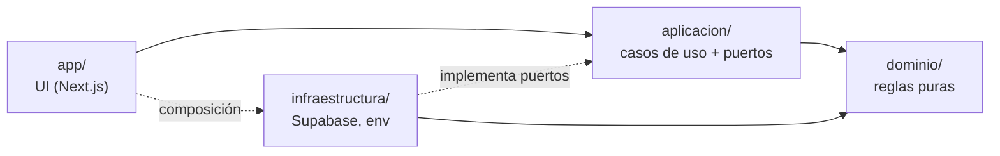

# Arquitectura

## Capas y regla de dependencias

| Capa                  | Contenido                                                                                                  | Puede depender de              | No puede depender de                       |
| --------------------- | ---------------------------------------------------------------------------------------------------------- | ------------------------------ | ------------------------------------------ |
| `src/dominio`         | Tipos, esquemas zod, generador de menú, lista de la compra, despensa                                       | zod                            | Next, React, Supabase, Node, otras capas   |
| `src/aplicacion`      | Casos de uso (p. ej. "elegir opción", "cocinar") y **puertos** (interfaces de repositorio)                 | dominio                        | Next, React, Supabase, infraestructura, UI |
| `src/infraestructura` | Clientes de Supabase, repositorios que implementan los puertos, mapeo fila ↔ dominio, variables de entorno | dominio, aplicacion, librerías | UI                                         |
| `src/app`             | Rutas, componentes, Server Actions finas que componen casos de uso con su infraestructura                  | todas                          | —                                          |

**Se comprueba automáticamente:** `no-restricted-imports` en `eslint.config.mjs` hace fallar el lint (y la CI) si una capa importa algo prohibido, también con rutas relativas.

### Por qué así

- El **dominio** concentra el valor del producto (equilibrio nutricional, opciones, compra). Al ser puro y determinista (recibe `hoy` y la semilla como parámetros) se prueba sin red ni base de datos, y los tests son rápidos y fiables.
- Los **puertos** permiten probar los casos de uso con repositorios en memoria y cambiar Supabase sin tocar la lógica.
- Las **Server Actions** son finas: validan la entrada con zod, llaman a un caso de uso y devuelven el resultado.

## Validación y seguridad en profundidad

1. **Borde:** todo dato externo (formularios, filas de la base de datos, seed, respuestas de IA) se valida con zod antes de entrar al dominio.
2. **Dominio:** invariantes de negocio (no repetir plato, mismo grupo consecutivo…).
3. **Base de datos:** RLS por hogar, FK compuestas con `hogar_id`, `CHECK` y funciones transaccionales para operaciones de varios pasos (cocinar / deshacer).

La RLS es la última línea de defensa, no la única.

## Errores

- **Errores esperados** (p. ej. "no hay combinación que cumpla todas las restricciones") son **valores** en el tipo de retorno, con un motivo legible para la UI.
- **Errores de programación o de infraestructura** se lanzan como excepciones y se registran.

## Estrategia de tests

| Nivel       | Qué                                                             | Herramienta                              | Cuánto                                                           |
| ----------- | --------------------------------------------------------------- | ---------------------------------------- | ---------------------------------------------------------------- |
| Unitario    | Dominio (incluidos tests de propiedades: "nunca repite plato")  | Vitest (+ fast-check)                    | Mucho; cobertura mínima del 90 % en `src/dominio`, exigida en CI |
| Integración | Migraciones, RLS, funciones SQL, repositorios                   | `scripts/db-test.sh` (Postgres 17 en CI) | Cada tabla y política                                            |
| E2E         | 2-3 flujos críticos (acceso, elegir comida, lista de la compra) | Playwright                               | Pocos y estables                                                 |

Los tests de seguridad se validan con **mutaciones** (romper la política a propósito y comprobar que el test falla).

## Flujo de trabajo

- **Ramas cortas por funcionalidad** desde `main`, PR con CI obligatoria y fusión por _squash_.
- **Commits convencionales en español:** `feat:`, `fix:`, `docs:`, `chore:`, `ci:`, `test:`, `refactor:`.
- **Plantilla de PR** con la definición de hecho (`.github/pull_request_template.md`).
- **Dependabot** semanal para dependencias y mensual para las Actions.
- **Decisiones** registradas en `docs/decisiones.md` (formato ADR ligero).

## Definición de hecho

Un cambio está terminado cuando:

1. `pnpm check` y la CI están en verde.
2. El dominio sigue puro y con la cobertura exigida.
3. Si toca la base de datos: migración en el repositorio, tests de RLS, advisors revisados y tipos regenerados.
4. Si toca la interfaz: probado en móvil.
5. Las decisiones relevantes están documentadas.
