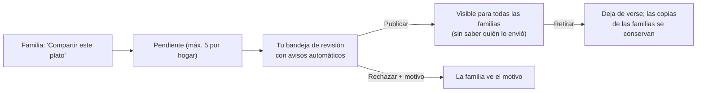

# Moderación del catálogo comunitario

Objetivo: que revisar un plato cueste **un toque y menos de un minuto**. La app hace el trabajo
previo y te señala solo en qué fijarte.

## Cómo te das de alta como administrador

Una sola vez, tras crear tu cuenta en la app. En el panel de Supabase → SQL Editor:

```sql
insert into public.administrador_plataforma (user_id)
select id from auth.users where email = '<tu-email>';
```

No hay otra forma de ser administrador: la tabla no es accesible desde la API (política que
deniega todo) y solo la consultan funciones internas.

## El flujo, de un vistazo



## La bandeja

Cada plato pendiente aparece como una tarjeta con todo lo necesario para decidir sin abrir nada
más: nombre, tiempo, ingredientes con cantidad y unidad, pasos y, lo más útil, los **avisos**.

| Aviso               | Qué significa                                  | Qué hacer                                                                    |
| ------------------- | ---------------------------------------------- | ---------------------------------------------------------------------------- |
| _(ninguno)_         | Pasa todas las comprobaciones automáticas      | Léelo en 10 segundos y publica                                               |
| `ingrediente_nuevo` | Usa un ingrediente que nadie ha verificado aún | Comprueba que el nombre y la unidad tienen sentido. **Publicar lo verifica** |
| `sin_pasos`         | Pasos vacíos o de menos de 20 caracteres       | Rechaza: "Faltan los pasos"                                                  |
| `tiempo_alto`       | Más de 45 minutos en total                     | Es válido, pero no es "rápido": publica sin la etiqueta o rechaza            |
| `enlace_en_texto`   | Hay una URL en el nombre o en los pasos        | Casi siempre receta copiada: rechaza                                         |
| `posible_duplicado` | Ya hay un plato publicado con el mismo nombre  | Rechaza como duplicado o publica si es una variante clara                    |
| `sin_ingredientes`  | No tiene ingredientes                          | Rechaza                                                                      |

## Criterios (30 segundos)

1. **Es de la familia**: escrito con sus palabras, sin enlaces ni texto copiado de una web.
2. **Cantidades razonables** por ración (150 g de pollo sí, 1,5 kg no).
3. **Rápido y sencillo**: tiempo coherente y pocos pasos. Cabe de todo, pero se prioriza esto.
4. **Nada inapropiado** en nombre, pasos ni alias.

## Motivos de rechazo habituales

"Copiado de una web, escríbelo con tus palabras" · "Faltan los pasos" · "Cantidades poco
realistas" · "Duplicado de otro plato" · "No es apto para el catálogo".

## Qué ven las familias

- **Al publicar:** el plato aparece para todas, **sin ninguna referencia a quién lo envió**. Solo
  se muestra el alias opcional que la familia haya elegido.
- **Al rechazar:** la familia ve el motivo y puede corregirlo y volver a enviarlo.
- **Al retirar:** deja de verse en la biblioteca; las copias que ya adoptaron otras familias se
  conservan, porque son suyas.

## Límites que protegen tu tiempo

- Cada hogar puede tener **como máximo 5 platos pendientes** a la vez.
- Cada usuario puede crear **como máximo 50 ingredientes nuevos al día**.
- Un plato no se puede enviar dos veces mientras esté pendiente o publicado.
- Los platos **adoptados** de la biblioteca no se pueden volver a enviar.

## Mejoras previstas (no incluidas todavía)

Aviso al autor cuando se revisa su plato · publicar en lote los que no tienen avisos, cuando haya
confianza · segundos moderadores · valoraciones agregadas y reportes de los usuarios.
